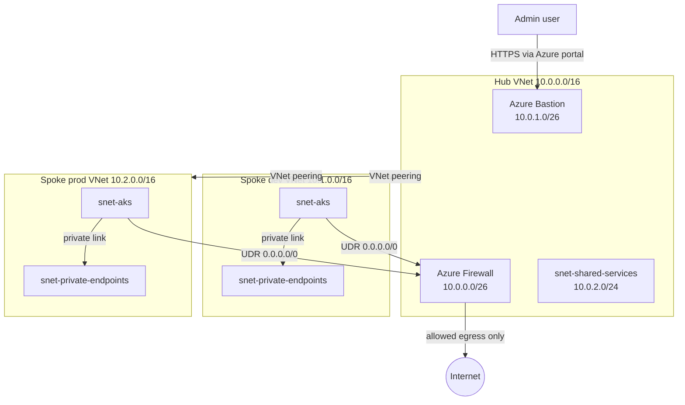

# Azure Hub-and-Spoke Network Foundation (Terraform)


A modular Terraform implementation of an Azure hub-and-spoke network: a shared hub VNet with Azure Firewall and Azure Bastion, two isolated spoke VNets (dev and prod), forced egress through the Firewall, deny-by-default NSGs, and a Key Vault reachable only through a Private Endpoint. Each part (bootstrap, hub, dev, prod) has its own Terraform root and its own remote state.

> This is a personal, sandbox-scale project. It is not a multi-subscription enterprise landing zone, and the Firewall/Bastion hub has not been deployed to Azure (see [What is verified](#what-is-verified)).

## What is verified

| Check | Status |
|---|---|
| `terraform fmt`, `init -backend=false`, `validate` on all 4 roots | Runs in CI on every PR and push |
| TFLint (terraform recommended preset + azurerm ruleset) | Runs in CI, 0 issues on the current code |
| Checkov security scan | Runs in CI in report-only mode (does not fail the build) |
| `terraform test` | Not added yet, see [Testing and validation](#13-testing-and-validation) |
| Deployment to Azure | Only the `bootstrap` root (state storage) was applied and then destroyed. Hub and spokes were never deployed, because Azure Firewall and Bastion are billed hourly |

Nothing in this README claims more than the table above.

## Table of contents

1. [Project overview](#1-project-overview)
2. [Business problem](#2-business-problem)
3. [Architecture](#3-architecture)
4. [Network topology](#4-network-topology)
5. [Repository structure](#5-repository-structure)
6. [Terraform modules](#6-terraform-modules)
7. [Hub-and-spoke implementation](#7-hub-and-spoke-implementation)
8. [Network security](#8-network-security)
9. [Firewall and routing](#9-firewall-and-routing)
10. [Bastion access](#10-bastion-access)
11. [Terraform state management](#11-terraform-state-management)
12. [CI/CD and security scanning](#12-cicd-and-security-scanning)
13. [Testing and validation](#13-testing-and-validation)
14. [Known limitations and future improvements](#14-known-limitations-and-future-improvements)

## 1. Project overview

- Azure hub-and-spoke network built entirely with Terraform (azurerm `~> 4.0`, Terraform `>= 1.7`).
- One shared hub (`10.0.0.0/16`) and two spokes: dev (`10.1.0.0/16`) and prod (`10.2.0.0/16`).
- Seven reusable modules, composed by four separate roots: `bootstrap`, `hub`, `spoke-dev`, `spoke-prod`.
- Security controls in code: deny-by-default NSG, Firewall policy per spoke, forced egress through the Firewall, Bastion for admin access, Key Vault with a Private Endpoint and private DNS, RBAC scoped to a resource group.
- Quality gates in CI: format, validate, TFLint and Checkov.

## 2. Business problem

When several environments share a cloud network, three problems appear quickly:

- **Shared services get duplicated.** Every environment ends up with its own firewall and admin access path.
- **Environments can reach each other.** A mistake in dev should not be able to touch prod.
- **Outbound traffic is uncontrolled.** Workloads reach the internet directly and nobody sees or limits it.

A hub-and-spoke layout answers these: the Firewall and Bastion exist once in the hub, each environment gets its own spoke, spoke egress goes through the Firewall, and there is no direct path between dev and prod. This repository is a practice implementation of that pattern. It has no real customer or workload behind it.

## 3. Architecture



Dev and prod are not peered with each other, and the Firewall policy has a rule that denies spoke-to-spoke traffic. This is the design in code. It has not been tested in a live Azure subscription.

## 4. Network topology

| Network | VNet CIDR | Subnet | Subnet CIDR |
|---|---|---|---|
| Hub | 10.0.0.0/16 | AzureFirewallSubnet | 10.0.0.0/26 |
| Hub | 10.0.0.0/16 | AzureBastionSubnet | 10.0.1.0/26 |
| Hub | 10.0.0.0/16 | snet-shared-services | 10.0.2.0/24 |
| Spoke dev | 10.1.0.0/16 | snet-aks, snet-private-endpoints | set by variables |
| Spoke prod | 10.2.0.0/16 | snet-aks, snet-private-endpoints | set by variables |

The hub subnet ranges above are the defaults in `environments/hub/variables.tf`. Spoke subnet ranges are variables in the spoke roots. The design document `docs/target-architecture.md` proposes `/22` for `snet-aks` and `/24` for `snet-private-endpoints`.

The address ranges do not overlap, so hub-to-spoke peering is possible.

## 5. Repository structure

```
azure-network-foundation-terraform/
|-- .github/workflows/terraform-ci.yml   # fmt + validate (4 roots), Checkov, TFLint
|-- .tflint.hcl                          # TFLint config (terraform + azurerm rulesets)
|-- environments/
|   |-- bootstrap/    # state storage: resource group, storage account, container (local state)
|   |-- hub/          # hub VNet, Firewall, Bastion (remote state)
|   |-- spoke-dev/    # dev spoke: network, peering, Key Vault, RBAC (remote state)
|   `-- spoke-prod/   # prod spoke, same structure as dev (remote state)
|-- modules/
|   |-- hub-network/  |-- spoke-network/  |-- peering/  |-- firewall/
|   `-- bastion/      |-- key-vault/      `-- rbac/
|-- docs/             # architecture.md, target-architecture.md, screenshots/
|-- diagrams/         # architecture.png
|-- tests/            # placeholder, see section 13
|-- CHANGELOG.md
`-- LICENSE
```

## 6. Terraform modules

| Module | What it creates |
|---|---|
| `hub-network` | Hub VNet with `AzureFirewallSubnet`, `AzureBastionSubnet` and `snet-shared-services` |
| `spoke-network` | Spoke VNet, `snet-aks`, `snet-private-endpoints`, AKS NSG, route table to the Firewall and the associations |
| `peering` | Hub-to-spoke and spoke-to-hub VNet peerings, named from `spoke_name` |
| `firewall` | Public IP, Firewall policy, Azure Firewall, and one rule collection group per spoke |
| `bastion` | Public IP and Azure Bastion host (`Basic` by default, `Standard` optional) |
| `key-vault` | Key Vault, private DNS zone, DNS zone link and Private Endpoint |
| `rbac` | Role assignments scoped to a resource group |

Every module declares `required_version` and the `azurerm ~> 4.0` provider in its own `versions.tf`.

## 7. Hub-and-spoke implementation

- The **hub root** creates the resource group, the hub network, the Firewall and the Bastion. It receives the spoke address ranges as an input variable so the Firewall can build rules per spoke.
- Each **spoke root** creates its own resource group, spoke network, peering, Key Vault and an optional RBAC assignment. It reads the hub outputs (VNet ID, resource group, Firewall private IP) from the hub remote state through `terraform_remote_state`.
- Peering is created from the spoke root in both directions. Forwarded traffic is allowed, gateway transit and remote gateways are off.
- Deploy order is: bootstrap, then hub, then spokes.

## 8. Network security

- **NSG on `snet-aks`**: an explicit `DenyAllInbound` rule at priority 4096, with allow rules for `VirtualNetwork` (priority 100) and `AzureLoadBalancer` (priority 110). Nothing is left on Azure defaults by accident.
- **Key Vault**: RBAC authorization instead of access policies, purge protection on, 7-day soft delete, public network access disabled, network ACL default `Deny`, and access through a Private Endpoint with the `privatelink.vaultcore.azure.net` private DNS zone linked to the spoke VNet.
- **RBAC**: assignments are scoped to the spoke resource group, not the subscription. In the spoke roots, a `Network Contributor` assignment is created for an AKS identity only if a principal ID is provided.
- **No public IPs on workloads**: the only public IPs in the design belong to the Firewall and the Bastion.

## 9. Firewall and routing

- **SKU**: `Standard` by default, `Premium` allowed. `Basic` is rejected by a variable validation.
- **Rule structure**: one rule collection group per spoke. In each group a network rule collection (priority 110) denies traffic from that spoke to all spoke ranges, and an application rule collection (priority 310) allows HTTPS only to a short FQDN list: `*.azmk8s.io`, `mcr.microsoft.com`, `*.data.mcr.microsoft.com`, `management.azure.com` and `login.microsoftonline.com`.
- **No DNS rule**: an open UDP 53 rule existed earlier and was removed. VMs use the default Azure DNS.
- **Routing**: a route table sends `0.0.0.0/0` from `snet-aks` to the Firewall private IP (next hop `VirtualAppliance`). A Firewall rule only matters if traffic is routed to it, and this route is what does that.

## 10. Bastion access

- Azure Bastion is deployed in `AzureBastionSubnet` in the hub. SKU is `Basic` by default and `Standard` is selectable. Basic costs less and is enough for browser-based SSH and RDP.
- The intent is that no VM needs its own public IP for administration.
- **Not tested**: there are no VMs in this project and Bastion was never deployed, so access from the hub Bastion to spoke VMs over peering is a design intent, not a verified result.

## 11. Terraform state management

| Root | State |
|---|---|
| `bootstrap` | Local state. It creates the storage that holds the other states |
| `hub`, `spoke-dev`, `spoke-prod` | `azurerm` backend, one state key per root (`hub.tfstate`, `spoke-dev.tfstate`, `spoke-prod.tfstate`) |

- Backend settings: resource group `rg-tfstate`, storage account `azurecloudtfstate01`, container `tfstate`.
- The storage account is created by the `bootstrap` root (LRS, TLS 1.2, private container, blob versioning on, 7-day delete retention).
- The subscription ID is never committed. Pass it as `TF_VAR_subscription_id`.
- `bootstrap` was applied to a live subscription once (3 resources) and then destroyed. After a destroy, the other roots cannot `init` with their backend until `bootstrap` is applied again.

## 12. CI/CD and security scanning

`.github/workflows/terraform-ci.yml` runs on every pull request to `main` and every push to `main`:

| Job | What it does |
|---|---|
| Format and Validate (x4) | Matrix over `bootstrap`, `hub`, `spoke-dev`, `spoke-prod`: `terraform fmt -check -recursive`, `init -backend=false`, `validate` (Terraform 1.7.5) |
| Checkov scan | Terraform framework scan of the whole repo, `soft_fail: true`, so findings are reported without failing the build |
| TFLint | `tflint --recursive` with the terraform recommended preset and the azurerm ruleset |

**Not implemented yet**: `terraform plan` in CI, apply automation, OIDC to Azure and a GitHub Environment approval gate. Plan and apply need Azure credentials, and this project does not deploy automatically.

## 13. Testing and validation

- **Done**: `fmt`, `validate` and TFLint on all roots and modules, locally and in CI.
- **Not done yet**: automated `terraform test` coverage. `tests/` only contains a README. A first set of plan-time tests with a mocked provider is planned for the Firewall, peering and spoke-network modules.
- **Checkov**: it runs in report-only mode. A review of its findings, with fixes and accepted limitations, has not been written yet.

## 14. Known limitations and future improvements

- **Not deployed**: the hub (Firewall, Bastion) and spokes have never been applied, so there is no live evidence for them.
- **NSG scope**: `AllowVnetInbound` uses the `VirtualNetwork` service tag, which in Azure also covers peered VNet ranges. It is broader than the spoke itself. This is documented as a limitation and not narrowed in this version.
- **Private Endpoint subnet**: only `snet-aks` has an NSG and a route table. `snet-private-endpoints` has neither.
- **Firewall allow-list**: the FQDN list is a small starting set. It has not been checked against a real AKS cluster, which needs more outbound destinations.
- **No workloads**: no VM or AKS cluster exists. The subnets are ready for one.
- **Bootstrap state is local**: the storage account that holds remote state has its own state in a local file.
- **Storage account for state**: public network access and shared key access are enabled.
- **Single subscription**: no management groups and no Azure Policy.

Planned improvements:

- [ ] Plan-time `terraform test` coverage for the modules
- [ ] Documented Checkov findings with fixes and accepted limitations
- [ ] `terraform plan` in CI, then OIDC and an approval gate before any apply
- [ ] Narrow the NSG `VirtualNetwork` rule
- [ ] Short, budget-controlled deployment of the hub with screenshots, then destroy

## License

[MIT](LICENSE)

---

**Aniket Kumar** - DevOps Engineer

[GitHub](https://github.com/aniket-devop) | [LinkedIn](https://linkedin.com/in/aniket484)