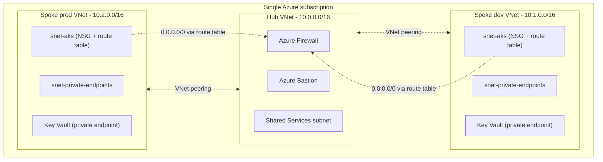
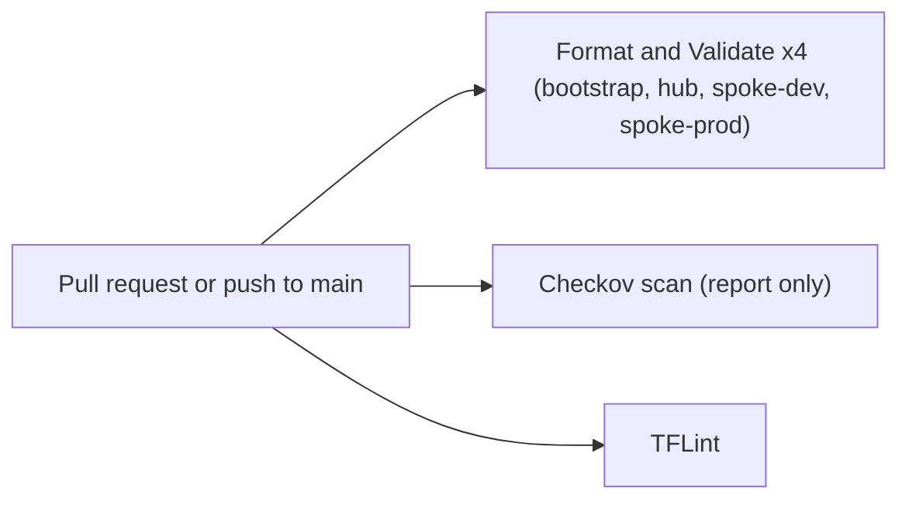

# Architecture

This document shows the design as implemented in Terraform. For the planned design and its trade-offs see [target-architecture.md](target-architecture.md). For what is verified, see the README.

## Overview

There is no management group or Azure Policy in this project. Dev and prod are not peered with each other, and the Firewall policy has a rule that denies spoke-to-spoke traffic. This is the design in code. The hub and spokes have not been deployed to Azure.

## CI status (current)

Not implemented yet: terraform plan in CI, apply automation, OIDC to Azure, approval gates and automated terraform tests. This diagram is updated only after each one is added and confirmed in a real Actions run.

## Design decisions and trade-offs

| Decision | Alternative considered | Why this one |
|---|---|---|
| Hub-and-spoke | Flat single VNet | Firewall and Bastion exist once in the hub instead of per environment |
| Four Terraform roots with separate state | One root for everything | Smaller blast radius per apply, independent state per environment |
| NSG with explicit DenyAllInbound on the AKS subnet | Relying on Azure default rules | The deny-by-default posture is visible and version-controlled |
| Route table sending 0.0.0.0/0 to the Firewall | Direct internet egress | Firewall rules only matter if traffic is routed to them |
| Azure Bastion | Jump box with a public IP | No VM needs its own public IP for administration |
| Key Vault with Private Endpoint and private DNS, public access disabled | Network ACL only | Access goes through the private network only |
| RBAC scoped to a resource group | Subscription-level Owner or Contributor | Blast radius of a compromised credential is one resource group |
| Manual apply, no apply automation | Auto-apply on merge to main | A human reads the plan first; Firewall and Bastion are billed hourly |