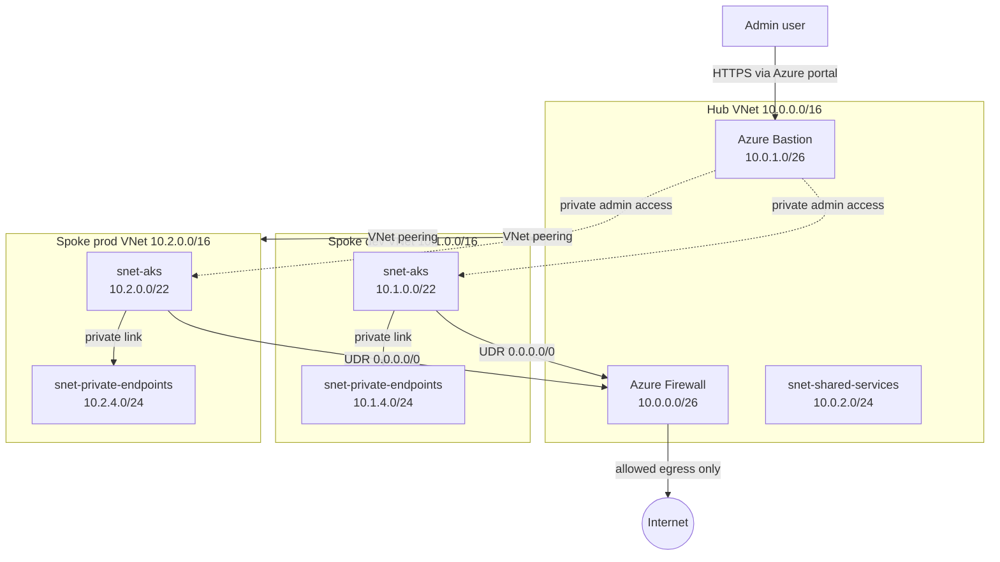

# Target Architecture (Planned Design)

> **Status: PLANNED DESIGN.** Nothing described in this document is deployed to Azure yet.
> See the implementation status table at the end of this document for what is validated, planned, deployed, or tested.

## 1. Purpose

This document describes the target Azure hub-spoke network foundation that this repository is being refactored towards.
It is a design document. The Terraform code in the repository does not fully match it yet.

Goals:

- One shared hub network with centralized egress control and admin access.
- Two isolated spokes: dev and prod.
- No direct network path between dev and prod.
- Private access to Key Vault (Private Endpoint and Private DNS).
- No public IP addresses on workload or admin VMs.

## 2. Address Plan

| Network | VNet CIDR | Subnet | Subnet CIDR | Purpose |
|---------|-----------|--------|-------------|---------|
| Hub | 10.0.0.0/16 | AzureFirewallSubnet | 10.0.0.0/26 | Azure Firewall |
| Hub | 10.0.0.0/16 | AzureBastionSubnet | 10.0.1.0/26 | Azure Bastion |
| Hub | 10.0.0.0/16 | snet-shared-services | 10.0.2.0/24 | Shared services |
| Spoke dev | 10.1.0.0/16 | snet-aks | 10.1.0.0/22 | AKS nodes |
| Spoke dev | 10.1.0.0/16 | snet-private-endpoints | 10.1.4.0/24 | Private Endpoints |
| Spoke prod | 10.2.0.0/16 | snet-aks | 10.2.0.0/22 | AKS nodes |
| Spoke prod | 10.2.0.0/16 | snet-private-endpoints | 10.2.4.0/24 | Private Endpoints |

Address ranges do not overlap, so peering between hub and each spoke is possible.

## 3. Architecture Diagram

Dev and prod have no direct peering and no Firewall allow rule between them.

## 4. Traffic Flows

| Flow | Path | Control |
|------|------|---------|
| Spoke egress to internet | Spoke subnet -> UDR 0.0.0.0/0 -> Azure Firewall -> Internet | Route table on spoke subnets, Firewall rules per spoke |
| Admin access | Admin -> Azure portal -> Bastion -> VM private IP | No public IP on VMs, Bastion in hub |
| Key Vault access | Workload -> Private Endpoint -> Key Vault | Private DNS zone, public network access restricted |
| Dev to prod | Not allowed | No direct peering, no Firewall allow rule |
| Hub to spoke | Allowed through VNet peering | Peering with explicit names per spoke |

Note: the UDR sends spoke egress to the Firewall. Return traffic and Firewall rule design are part of Phase 4.

## 5. Terraform Layout and State

Three separate Terraform roots, each with its own remote state:

| Root | State file | Contents |
|------|-----------|----------|
| environments/hub | hub.tfstate | Hub VNet, Firewall, Bastion, shared subnet |
| environments/spoke-dev | spoke-dev.tfstate | Dev spoke VNet, route table, NSG, peering, Key Vault |
| environments/spoke-prod | spoke-prod.tfstate | Prod spoke VNet, route table, NSG, peering, Key Vault |

Deploy order: hub first, then spokes.
Spokes read hub outputs through `terraform_remote_state`.
The hub receives spoke CIDR ranges as input variables, so it can build Firewall rules per spoke.

Remote state storage (resource group and storage account) will be created by a separate bootstrap step before the first `terraform init` with a backend.

## 6. Design Trade-offs

| Decision | Benefit | Trade-off | Mitigation |
|----------|---------|-----------|------------|
| One shared hub for dev and prod | Lower cost, one Firewall and one Bastion | Shared blast radius, no pre-prod hub to test hub changes | Per-spoke Firewall rule collections, separate NSGs, state files and RBAC per spoke |
| Three separate Terraform roots | Smaller blast radius per apply, independent state | More folders, strict deploy order | Documented order: hub first, then spokes |
| `terraform_remote_state` between roots | Simple way to share hub outputs | Spokes depend on the hub state layout and read access to it | Keep hub outputs small and stable |
| Azure Firewall for egress | Central control and logging | Hourly billing while deployed | SKU is a variable, deploy only for short tests with a budget alert |

Note: larger enterprises often use separate non-production and production hubs. This project uses one hub to keep cost and scope manageable, and documents the risk instead of hiding it.

## 7. Implementation Status

Legend: Locally validated = `terraform init -backend=false` and `terraform validate` passed. Planned = designed, not implemented. Deployed = exists in Azure. Tested = automated tests exist and passed.

| Item | Status |
|------|--------|
| hub-network module contract restored, azurerm ~> 4.0 (PR #1) | Locally validated, CI validate passed on dev |
| Existing dev and prod environments (old single-root layout) | Locally validated only |
| Split into hub, spoke-dev, spoke-prod roots | Planned |
| Remote state bootstrap (resource group, storage account) | Planned |
| Route table forcing 0.0.0.0/0 to Firewall | Planned (not in code yet) |
| Unique peering names per spoke | Planned |
| Per-spoke Firewall rules and FQDN rules | Planned |
| Key Vault Private Endpoint and Private DNS | Planned |
| CI: fmt, init, validate (dev only) | Implemented |
| CI: TFLint, Checkov, plan, OIDC, approval gates | Planned |
| Deployment to Azure | Not deployed |
| Automated tests | None yet |

## 8. Cost and Deployment Approach

Azure Firewall and Azure Bastion are billed per hour while deployed, so cost control is part of the design.

Approach:

1. Build and validate first, without deploying: `terraform fmt`, `validate`, TFLint, Checkov and `terraform plan` in CI.
2. A short real test of the hub only is planned for later. It will happen only after explicit approval, and only after the conditions below are met.
3. Spokes and a full deployment are out of scope until the hub test is done and reviewed.

Conditions before any real deployment:

- Check current prices for the target region in the Azure Pricing Calculator (list prices differ by region and SKU).
- Create an Azure budget alert first.
- Use the lowest suitable Firewall and Bastion SKUs (SKU is a variable in the modules).
- Deploy only for a short window (a few hours), then run `terraform destroy`.

Teardown verification:

- Run `terraform destroy` for the hub.
- Run `az group list` and confirm that no project resource group remains.
- Check Cost Management the next day for unexpected charges.

Until this test is done, this repository is described as validated and planned, not deployed.
